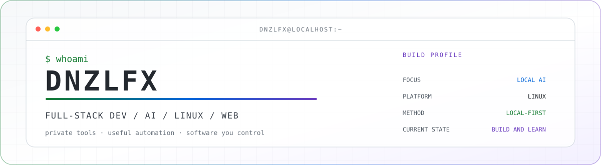

<div align="center">

<picture>
  <source media="(prefers-color-scheme: dark)" srcset="./assets/profile-header-dark.svg" />
  <source media="(prefers-color-scheme: light)" srcset="./assets/profile-header-light.svg" />
  
</picture>

<br />

[](https://github.com/dnzlfx)


[](https://github.com/dnzlfx)

<br />

`IA local` · `agentes autónomos` · `automatización` · `privacidad` · `Linux` · `web`

</div>

---

## `01 // SOBRE MÍ`

Construyo herramientas que puedo **ejecutar, entender y controlar**. Mi trabajo vive en la intersección de la inteligencia artificial local, la automatización útil y experiencias web con identidad visual propia.

<table>
<tr>
<td width="50%" valign="top">

### ⚡ Qué estoy explorando

- Agentes con memoria, herramientas, visión y voz
- Inferencia local de modelos con Ollama
- Automatización de tareas y de homelab
- Interfaces útiles con identidad fuerte

</td>
<td width="50%" valign="top">

### 🧭 Cómo me gusta construir

- **Local-first:** los datos se quedan bajo tu control
- **Práctico:** primero que funcione, luego que mejore
- **Abierto:** software entendible y modificable
- **Curioso:** aprender construyendo, probando y rompiendo

</td>
</tr>
</table>

```text
christian@localhost:~$ estado
→ construyendo software privado, autónomo y genuinamente útil
```

## `02 // PROYECTOS DESTACADOS`

<table>
<tr>
<td width="50%" valign="top">

### 🧠 [Vyn — Voice Your Needs](https://github.com/dnzlfx/Vyn)

Agente autónomo local-first con inferencia vía Ollama, memoria persistente, búsqueda web, sandbox de código, visión y herramientas de administración de homelab por SSH.


[**Ver el proyecto →**](https://github.com/dnzlfx/Vyn)

</td>
<td width="50%" valign="top">

### 👁️ [Samantha](https://github.com/dnzlfx/Samantha)

Asistente multimodal con voz, visión, monitoreo de pantalla y detección de intención, pensado como copiloto visual para tareas, diagnóstico y depuración.


[**Ver el proyecto →**](https://github.com/dnzlfx/Samantha)

</td>
</tr>
<tr>
<td width="50%" valign="top">

### 🔎 [Local AI Assistant](https://github.com/dnzlfx/Local_AI_Assistant)

Asistente configurable construido sobre modelos locales, con búsqueda web contextual, cambio de modelo en caliente y guardado automático de sesiones.


[**Ver el proyecto →**](https://github.com/dnzlfx/Local_AI_Assistant)

</td>
<td width="50%" valign="top">

### 🦊 [FoxTube](https://github.com/dnzlfx/foxtube)

Frontend privado y autoalojado para YouTube sobre Invidious, con interfaz propia, recomendaciones locales, Shorts y despliegue en contenedores. Licencia MIT.


[**Ver el proyecto →**](https://github.com/dnzlfx/foxtube)

</td>
</tr>
<tr>
<td width="50%" valign="top">

### 🛒 [ProyectoPrograWeb](https://github.com/dnzlfx/ProyectoPrograWeb)

Sitio web estático (HTML, CSS y JavaScript) con varias páginas — catálogo, accesorios, blog y contacto — publicado con GitHub Pages.


[**Ver la demo →**](https://dnzlfx.github.io/ProyectoPrograWeb/)

</td>
<td width="50%" valign="top">

</td>
</tr>
</table>

<div align="center">

[Ver todos los repositorios](https://github.com/dnzlfx?tab=repositories)

</div>

## `03 // HERRAMIENTAS`

<div align="center">

### Lenguajes y web


### Sistemas, datos e IA


</div>

## `04 // ACTIVIDAD EN GITHUB`

<div align="center">

<picture>
  <source media="(prefers-color-scheme: dark)" srcset="./profile/stats-dark.svg" />
  <source media="(prefers-color-scheme: light)" srcset="./profile/stats-light.svg" />
  
</picture>

<picture>
  <source media="(prefers-color-scheme: dark)" srcset="https://streak-stats.demolab.com?user=dnzlfx&amp;hide_border=true&amp;background=0D1117&amp;ring=39D353&amp;fire=A78BFA&amp;currStreakNum=F0F6FC&amp;sideNums=F0F6FC&amp;currStreakLabel=39D353&amp;sideLabels=8B949E&amp;dates=8B949E&amp;locale=es" />
  <source media="(prefers-color-scheme: light)" srcset="https://streak-stats.demolab.com?user=dnzlfx&amp;hide_border=true&amp;background=FFFFFF&amp;ring=1A7F37&amp;fire=6F42C1&amp;currStreakNum=24292F&amp;sideNums=24292F&amp;currStreakLabel=1A7F37&amp;sideLabels=57606A&amp;dates=57606A&amp;locale=es" />
  
</picture>

</div>

### El calendario de contribuciones real está justo abajo

Aquí no incrusto una copia generada de la cuadrícula verde. Baja hasta después de los repositorios fijados y encontrarás el **calendario de contribuciones nativo de GitHub**. Cada cuadro proviene directamente de GitHub y puedes seleccionarlo para inspeccionar la actividad de ese día.

> GitHub decide qué cuenta como contribución. El trabajo público se muestra directamente; la actividad privada puede incluirse como conteos anónimos desde los **ajustes de contribuciones** del perfil.

---

<div align="center">

### `while (curioso) { construir(); aprender(); repetir(); }`

Si alguno de mis proyectos te resulta útil, una ⭐ siempre se agradece.

[](https://github.com/dnzlfx?tab=repositories)

</div>
